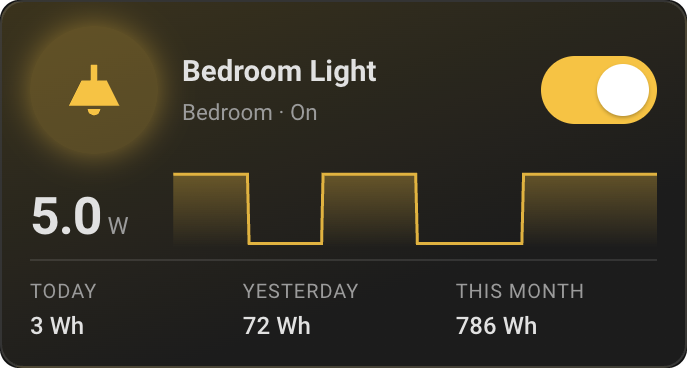

# Smart Plug Card

A Home Assistant dashboard card for **Shelly and Tasmota smart plugs**, or any switch or light with power monitoring.



- **On/off:** a toggle, and the icon is a button too. The card glows while the plug is on.
- **Live wattage** in large text, next to a **24-hour power graph**.
- **Energy used today, yesterday and this month.** These come from Home Assistant's long-term statistics, so they're right whether the plug's meter counts up forever (Shelly) or resets (Tasmota).
- **Cost** next to each energy figure, if you set a price per kWh.
- **History:** tap the name, the wattage or the totals to open the history for that entity.
- **Finds its own sensors.** It picks up the power and energy sensors on the plug's device, so usually you only set `entity`.
- **Visual editor** in the dashboard's card settings.

## Install

### Home Assistant Marketplace

1. Open **Marketplace** and choose **⋮ → Custom repositories**.
2. Add `https://github.com/joeladam518/homeassistant-smart-plug-card` with the type **Dashboard**.
3. Find **Smart Plug Card** and install it, then reload the browser.

### By hand

1. Download `smart-plug-card.js` from the [latest release](https://github.com/joeladam518/homeassistant-smart-plug-card/releases/latest) into `/config/www/`.
2. Go to **Settings → Dashboards → ⋮ → Resources → Add resource**:
   - URL: `/local/smart-plug-card.js?v=2.0.1`
   - Type: **JavaScript module**
3. Hard-refresh the browser. In the phone app, use **Settings → Companion app → Debugging → Reset frontend cache**.

When you update, change the `?v=` number so browsers load the new file.

## Options

```yaml
type: custom:smart-plug-card
entity: switch.desk_lamp # required: the plug (switch or light)
name: Desk Lamp # optional
icon: mdi:desk-lamp # optional, otherwise Home Assistant's icon for the entity
power: sensor.desk_lamp_power # optional, found on the same device
energy: sensor.desk_lamp_energy # optional, found on the same device
price: 0.13 # optional, your price per kWh; adds the cost next to each energy figure
```

| Option   | Default     | What it does                                                                                                                       |
| -------- | ----------- | ---------------------------------------------------------------------------------------------------------------------------------- |
| `entity` | required    | The plug. Any `switch`, `light` or `input_boolean`.                                                                                |
| `name`   | entity name | Card title.                                                                                                                        |
| `icon`   | entity icon | Any `mdi:` icon. Without it, the icon follows on/off.                                                                              |
| `power`  | auto        | Power sensor in W. The card finds it on the plug's device.                                                                         |
| `energy` | auto        | Energy sensor (kWh or Wh) with a `total` or `total_increasing` state class. The card prefers the lifetime total over daily meters. |
| `price`  | none        | Price per kWh, shown in Home Assistant's currency.                                                                                 |

**No energy numbers?** The totals need the energy sensor in Home Assistant's long-term statistics. That needs a `state_class`; the Shelly and Tasmota integrations set it already.

## Develop

Needs Node 22+.

```sh
npm install
npm run watch   # rebuild dist/smart-plug-card.js on every change
npm run check   # typecheck, lint, format check, build, tests (what CI runs)
npm run fmt     # format everything
```

- **Code:** TypeScript + [Preact](https://preactjs.com) function components in `src/` (`.tsx`), styles in `src/*.css` (PostCSS), built with [rolldown](https://rolldown.rs) into one file with Preact included.
- **Shared helpers** come from [`@joeladam518/shared-cards`](https://github.com/joeladam518/homeassistant-ui/tree/main/packages/shared-cards) on GitHub Packages. To install, put a token with `read:packages` in `~/.npmrc` as `//npm.pkg.github.com/:_authToken=<token>`.
- **Testing in Home Assistant:** copy `dist/smart-plug-card.js` to `/config/www/` and bump `?v=` on the resource.

**Releasing:** run `npm version <patch|minor|major>`, push with tags, then publish a GitHub release for the new `v…` tag. CI builds the card and attaches `smart-plug-card.js` to the release, which is what the Marketplace installs.

## License

MIT
